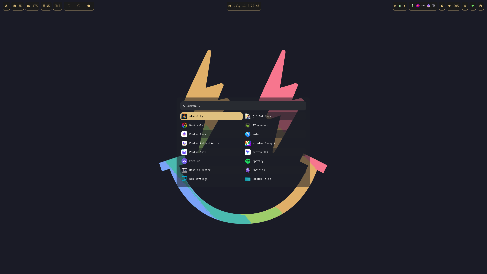

# Mango-Style
### An awsome configuration for MangoWM with a mostly orange theme with a hint of green :)
Made for Arch Linux (use with SystemD) feel free to fork it for other distros/init-systems!

 

## Installation:
1. Install dependencies.
2. Download the files.  
`git clone https://codeberg.org/Void98/Mango-Style`
3. Copy the configs you want into the appropriate directories.  
`cp -r ~/Mango-Style/{mango,scripts,waybar,rofi} ~/.config/` 
`cp -r ~/Mango-Style/Wallpapers ~/`  
_All scripts and configs are designed to be in these locations, if you want to change it make sure to check everything so the paths are right!_
4. Make sure all scripts are executable!  
`chmod +rx ~/.config/scripts/*`  
5. That should be it, reboot and it should work.

## Dependencies:
**All:**
- `mangowm` (v0.18+)
- `rofi`
- `waybar-git`*  
  _Only the git version works as intended!_
- `xdg-desktop-portal-wlr` 

**Waybar modules:**
- custom/notifications
  - `swaync`
- pulseaudio
  - `pavucontrol`*  
  _(works without it)_
- custom/wifi
  - `iwd` (optionally /w Network Manager)
- Most modules
  - `ttf-jetbrains-mono-nerd`*  
  _Any nerd font works,but best experience with this font._

**Rofi:**
- `cosmic-icon-theme`*  
_Optional, has fallback icon theme_

**Wallpaper rotator scripts:**
- `swaybg`  

**Recommended:**
- `polkit-gnome` (policy manager)
- `wl-clipboard` & `wl-clip-presist` (better clipboard)
- `nwg-look` (GTK theme manager)
- `qt5ct` & `qt6ct` (qt/KDE app theme manager)
- `flameshot` (screenshot tool)
- `wlr-utils` (has some useful wlroots utilities) _(can be used as an alternative to rofi for screensahre window selection as it shows window previews)_  

### Used themes:
GTK: [orchis-nord-theme](https://aur.archlinux.org/packages/orchis-nord-theme-git) _*AUR_  
QT: [kvantum-theme-orchis](https://aur.archlinux.org/packages/kvantum-theme-orchis-git) _*AUR_  
Icons: `cosmic-icon-theme`

## Credits:

- Wallpapers: https://github.com/atraxsrc/tokyonight-wallpapers  

- Rofi configs: https://github.com/adi1090x/rofi  
_(Heavily relied on this for configurning, included some of their themes)_
